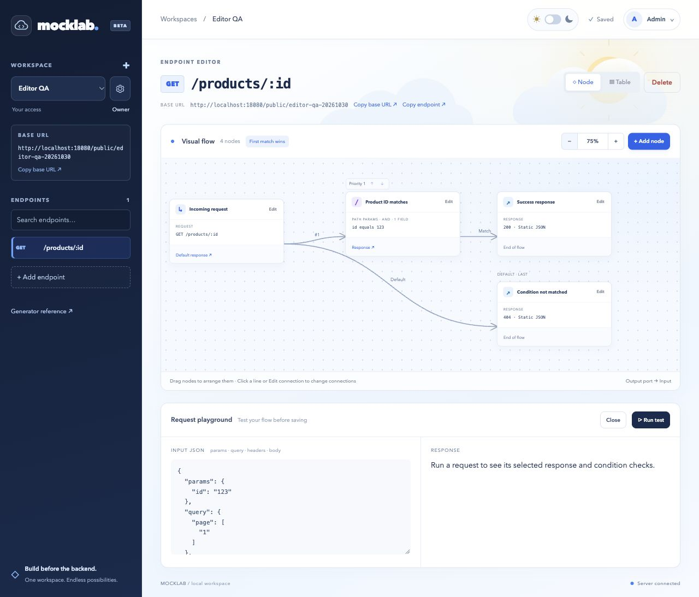

# Mocklab

Mocklab is a web application for building and running REST API mocks. Organize endpoints in workspaces, design Incoming → Condition → Response flows in Node or Table mode, and return Static or Dynamic JSON through callable URLs at `/public/{workspace-slug}/...`.

It includes request conditions, response generators, a testing Playground, login, and Viewer/Editor/Owner workspace access.

## Screenshot



## Tech stack and dependencies

| Area | Technology | Purpose |
| --- | --- | --- |
| Backend | Go 1.27.3, `net/http`, Chi v5.5.0 | Application server, management API, and mock execution |
| Database | PostgreSQL 17, pgx/v5 | Persistent workspaces, accounts, and JSONB flows |
| Templates | templ | Server-rendered, reusable UI components |
| Interactions | Alpine.js 3, Alpine Focus, HTMX 2 | Editor state, dialogs, and HTML status updates |
| Styling | Tailwind CSS 4, component CSS | Light/Night interface |
| Asset build | Node.js 24+, npm, Vite 7 | Dependency installation and CSS/JS bundling |
| Packaging | Docker or Podman with Compose, Make | Build and run Go with PostgreSQL |

Go is the only application server. Assets are embedded in the binary; Node.js is needed only for development/builds. Dependency definitions and locked versions are in [go.mod](go.mod), [go.sum](go.sum), [package.json](package.json), and [package-lock.json](package-lock.json).

## Architecture

The project follows clean architecture: domain rules are independent of transport, database, and UI. Use cases define repository ports; HTTP and PostgreSQL adapters connect them to the outside world. The server composes the concrete dependencies.

```text
cmd/server/                 Dependency wiring and server lifecycle
internal/domain/            Entities, flow and template validation
internal/usecase/           Application logic, matching and rendering
internal/adapter/http/      Routes, authentication and middleware
internal/adapter/postgres/  Persistence and embedded migrations
internal/web/               templ components and embedded assets
web/src/                    Alpine state, editor helpers and styling
```

Node and Table modes edit the same flow. PostgreSQL stores its configuration as JSONB; execution follows connections and condition priority, while node coordinates control presentation only. Chi groups HTTP route policies without changing templ components or domain/use-case dependencies. See [development and architecture](docs/DEVELOPMENT.md) and [routing/security boundaries](docs/ROUTING.md) for implementation details.

## Configuration and running

### 1. Configure the environment

```sh
cp .env.example .env
```

The supplied configuration starts in development mode:

| Variable | Purpose / default |
| --- | --- |
| `APP_ENV` | `development`; use the deployment guide for managed installations |
| `ADDR` | Local Go bind address: `127.0.0.1:8080` |
| `DATABASE_URL` | Local PostgreSQL connection string from `.env.example` |
| `APP_PORT` / `DB_PORT` | Optional Compose host ports; default to `8080` / `5432` |
| `PUBLIC_BASE_URL` | Optional advertised HTTP(S) origin; blank uses the browser origin |
| `ADMIN_USERNAME` / `ADMIN_PASSWORD` | Optional first-admin bootstrap credentials |
| `MOCK_CORS_ORIGINS` | Allowed frontend origins; blank permits same-origin browser requests |

If the default ports are occupied, set `APP_PORT` and `DB_PORT` in `.env`. For local Go development, also update the port in `DATABASE_URL` to match `DB_PORT`. Compose configures the application's internal database connection automatically.

### 2. Start with Compose

Requires Docker or Podman with a Compose provider. Host Go and Node.js installations are not needed for this option.

```sh
docker compose up --build -d
```

For Podman, use `podman compose up --build -d` instead. The stack starts PostgreSQL, waits for readiness, and applies database migrations automatically.

Open [http://localhost:8080/app](http://localhost:8080/app), or your configured `APP_PORT`. On a fresh development installation without bootstrap credentials, create the first administrator on the login page. There are no default login credentials. Bootstrap credentials initialize an empty user table; changing them later does not reset an existing account.

Stop with `docker compose down` or `podman compose down`. The database volume is preserved.

### 3. Alternatively, run Go locally

Requires Go 1.27.3, Node.js 24+ with npm, Make, and PostgreSQL 17. After configuring `.env`:

```sh
docker compose up -d db
make install
make dev
```

Use `podman compose up -d db` if using Podman. Make loads `.env`. To build a standalone binary, run `make build`; when running `./bin/mocklab` directly, provide environment variables yourself because the binary does not load `.env`.

### 4. Verify the application

```sh
curl http://localhost:8080/healthz
```

A healthy server returns `ok`. Create a workspace such as `demo-store`, add `GET /products/:id`, configure its response, and save. Then call:

```sh
curl http://localhost:8080/public/demo-store/products/123
```

Replace the origin/port and workspace slug as needed. Management pages require login; saved mock URLs are callable without a management session.

For internal deployment, HTTPS ingress, and CORS, see [Deployment](docs/DEPLOYMENT.md). For application workflows, see [Usage](docs/USAGE.md), [Dynamic JSON](docs/DYNAMIC_JSON.md), and [Access control](docs/ACCESS_CONTROL.md). The in-app generator reference is available at `/docs/generators` after signing in.

## Contributions

Read [CONTRIBUTING.md](CONTRIBUTING.md) before making changes. Run `make check`, document relevant changes in [CHANGELOG.md](CHANGELOG.md), and update the [roadmap](ROADMAP.md) when scope or status changes. Project documentation, code comments, and UI text use English.
